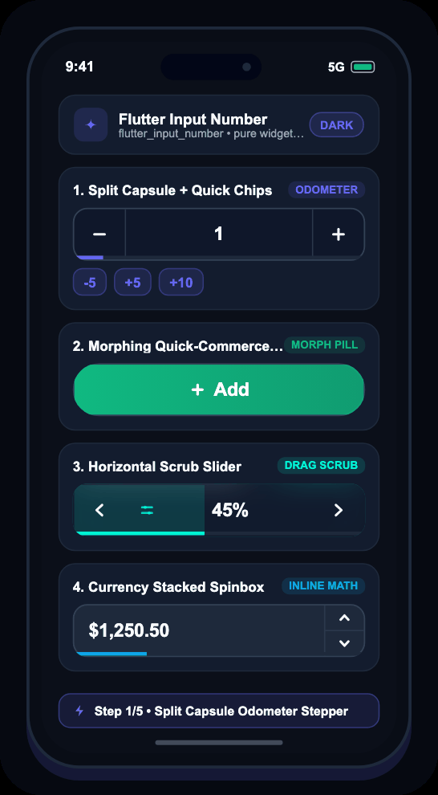
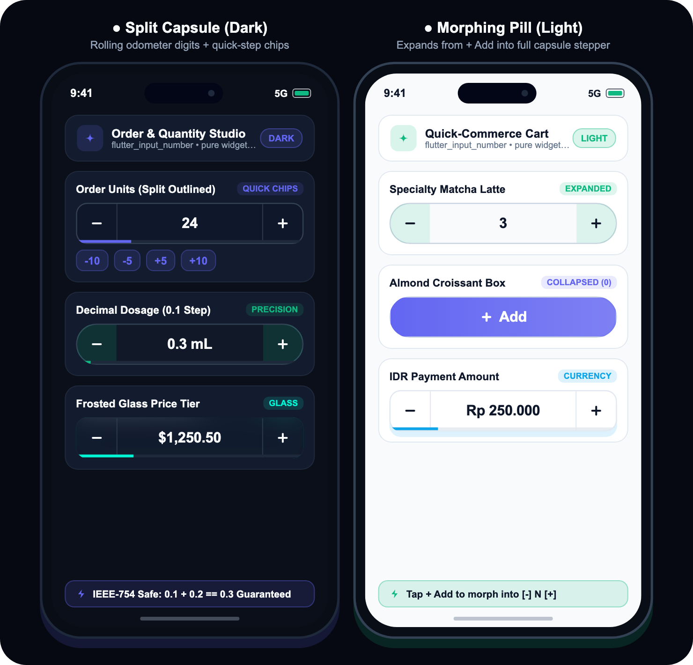
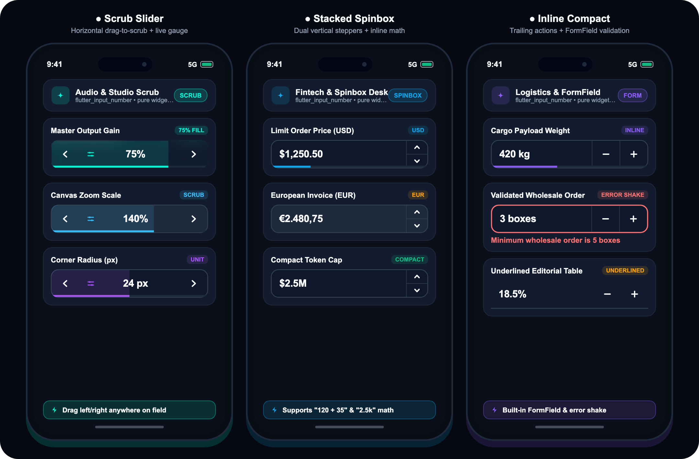

<p align="center">
  <a href="https://pub.dev/packages/flutter_input_number">
    
  </a>
</p>

<h1 align="center">flutter_input_number — Modern Flutter Input Number &amp; Stepper Widget</h1>

<p align="center">
  <strong>Modern, lightweight, zero-dependency Flutter input number, numeric stepper, and spinbox library.</strong><br/>
  5 interactive layouts • 6 visual presets • Horizontal scrub slider • Inline math evaluator • IEEE-754 precision math • Flutter 3.50+ ready
</p>

<p align="center">
  <a href="https://pub.dev/packages/flutter_input_number"></a>
  <a href="https://pub.dev/packages/flutter_input_number/score"></a>
  <a href="https://github.com/andikpbw/input-number-flutter/blob/main/LICENSE"></a>
  
  
  <a href="https://humanize.id"></a>
</p>

**`flutter_input_number`** is a next-generation **Flutter input number** and numeric stepper widget designed for modern mobile, web, and desktop applications. Built 100% on pure `package:flutter/widgets.dart` with **zero external dependencies** and **zero deprecated `package:flutter/material.dart` imports**, it drops seamlessly into apps using `package:material_ui/material_ui.dart` (Flutter 3.47+ / 3.50+), `package:cupertino_ui/cupertino_ui.dart`, legacy Material, or custom design systems.

> 🌟 Proudly supported by **[Humanize AI](https://humanize.id)**

---

## Live Real-UI Animation Preview

All previews below are rendered directly from the live `flutter_input_number` widget engine running inside mobile device frames:

<p align="center">
  
</p>

### All 5 Signature Flutter Input Number Layouts in Real Mobile Frames

<p align="center">
  
</p>

<p align="center">
  
</p>

---

## Why Choose `flutter_input_number`?

If you are looking for a **Flutter input number** widget that combines lightweight performance with modern UX, `flutter_input_number` reimagines numeric input from the ground up:

- **100% Pure `package:flutter/widgets.dart` & Flutter 3.50+ Future-Proof**: Zero imports of deprecated `package:flutter/material.dart` or `package:flutter/cupertino.dart`. Fully compatible with Flutter 3.50.0 / Dart 3.14.0 and `package:material_ui/material_ui.dart`.
- **5 Signature Interactive Layouts (`FlutterInputNumberLayout`)**:
  1. **`FlutterInputNumberLayout.splitCapsule`** (`[-] 24 [+]`) — Balanced left/right tactile stepper with spring button physics and vertical odometer digit transitions.
  2. **`FlutterInputNumberLayout.morphingPill`** (`+ Add` -> `[-] 3 [+]`) — Quick-commerce & food-delivery pill that stays compact at `0` and smoothly morphs into a full capsule stepper when active.
  3. **`FlutterInputNumberLayout.scrubSlider`** (`[◄ ──●── ►] 75%`) — Drag horizontally anywhere on the input to scrub numeric values with a live fill-progress gauge track, or tap to type an exact number.
  4. **`FlutterInputNumberLayout.stackedSpinbox`** (`$1,250.50 [▲/▼]`) — Desktop & SaaS precision spinbox with dual stacked micro-steppers, keyboard arrow/page shortcuts, and mouse wheel support.
  5. **`FlutterInputNumberLayout.inlineCompact`** (`420 kg [-][+]`) — Compact trailing stepper buttons ideal for dense forms, POS terminals, and inspector panels.
- **6 Modern Visual Theme Presets (`FlutterInputNumberStyle`)**:
  - One-line factories for `outlined`, `filled`, `capsule`, `glass` (frosted glassmorphism with `BackdropFilter`), `underlined`, and `elevated` in both **Light** and **Dark** modes.
- **IEEE-754 Precision Math & Inline Expression Evaluator (`PrecisionNumberMath`)**:
  - Eliminates floating-point drift (`0.1 + 0.2 == 0.3` guaranteed).
  - Users can type shorthand multipliers (`2.5k` -> `2500`, `1.2m` -> `1200000`) or inline math expressions (`120 + 35` -> `155`, `50 * 3` -> `150`, `200 + 10%` -> `220`) directly into the input field.
- **Built-in Currency, Locale & Unit Formatting (`FlutterInputNumberFormat`)**:
  - Ready-to-use presets for `standard`, `decimal`, `currency` (`$1,250.50`), `idr` (`Rp 1.250.000`), `european` (`€1.250,50`), `percentage` (`75.5%`), `unit` (`1,250 kg`), and `compact` (`$2.5M`).
- **Undo/Redo History, Quick-Step Chips & Damped Error Shake**:
  - `FlutterInputNumberController` includes bounded `undo()` / `redo()` stacks, normalized `progress` (`0.0..1.0`), programmatic `triggerError()` shake feedback, and optional `quickSteps: [-10, -5, 5, 10]` multiplier chips.

### Comparison: `flutter_input_number` vs Legacy Packages

| Capability | `flutter_input_number` | Legacy `input_number` | Raw `TextField` |
| :--- | :---: | :---: | :---: |
| **Pure `widgets.dart` (Flutter 3.50+ / `material_ui` ready)** | ✅ Yes | ❌ Uses `material.dart` | ❌ Manual |
| **Interactive Layouts** | **5 Layouts** (incl. Scrub & Morph Pill) | 4 Basic Layouts | 0 |
| **Theme Presets (Light & Dark)** | **6 Presets** (incl. Frosted Glass) | 4 Variants | Manual |
| **Inline Math (`120 + 35`, `2.5k`)** | ✅ Built-in | ❌ No | ❌ No |
| **Horizontal Drag-to-Scrub Slider** | ✅ Built-in | ❌ No | ❌ No |
| **Animated Odometer Digit Roll** | ✅ Slide / Scale / Fade | ❌ Static text | ❌ Static text |
| **Undo / Redo Value History Stack** | ✅ Built-in | ❌ No | ❌ No |
| **IEEE-754 Drift-Free Decimal Math** | ✅ `0.1 + 0.2 == 0.3` | ✅ Yes | ❌ Drift prone |

---

## Installation

Add `flutter_input_number` to your `pubspec.yaml`:

```yaml
dependencies:
  flutter_input_number: ^1.0.0
```

Or install via the Flutter CLI:

```bash
flutter pub add flutter_input_number
```

---

## Quick Start

### 1. Drop-in Flutter Input Number Widget

Works out of the box with `package:flutter/widgets.dart` or `package:material_ui/material_ui.dart` (both `FlutterInputNumber` and its concise alias `InputNumber` are exported):

```dart
import 'package:flutter/widgets.dart';
import 'package:flutter_input_number/flutter_input_number.dart';

class QuantityPickerCard extends StatelessWidget {
  const QuantityPickerCard({super.key});

  @override
  Widget build(BuildContext context) {
    return FlutterInputNumber(
      labelText: 'Order Quantity',
      initialValue: 1,
      min: 0,
      max: 99,
      step: 1,
      quickSteps: const [-5, 5, 10],
      style: FlutterInputNumberStyle.outlined(
        brightness: Brightness.dark,
        accentColor: const Color(0xFF6366F1),
        showProgressTrack: true,
      ),
      onChanged: (value) {
        debugPrint('Current quantity: $value');
      },
    );
  }
}
```

---

## Switching Between All 5 Interactive Layouts

Change the interaction paradigm with a single `layout` property:

```dart
// 1. Split Capsule: [-] 24 [+] with vertical odometer digit roll
FlutterInputNumber(
  initialValue: 24,
  min: 0,
  max: 100,
  layout: FlutterInputNumberLayout.splitCapsule,
)

// 2. Morphing Pill: collapses to "+ Add" at 0, expands to "[-] N [+]" when > 0
FlutterInputNumber(
  initialValue: 0,
  min: 0,
  max: 20,
  layout: FlutterInputNumberLayout.morphingPill,
  style: FlutterInputNumberStyle.capsule(
    accentColor: const Color(0xFF10B981),
  ),
)

// 3. Scrub Slider: drag horizontally anywhere on the bar or tap to type
FlutterInputNumber(
  initialValue: 75,
  min: 0,
  max: 100,
  step: 5,
  layout: FlutterInputNumberLayout.scrubSlider,
  format: const FlutterInputNumberFormat.percentage(),
  style: FlutterInputNumberStyle.glass(
    accentColor: const Color(0xFF00F5D4),
  ),
)

// 4. Stacked Spinbox: desktop & fintech dual vertical steppers
FlutterInputNumber(
  initialValue: 1250.50,
  min: 0,
  step: 25,
  precision: 2,
  layout: FlutterInputNumberLayout.stackedSpinbox,
  format: const FlutterInputNumberFormat.currency(symbol: r'$'),
)

// 5. Inline Compact: trailing side-by-side steppers for dense forms
FlutterInputNumber(
  initialValue: 420,
  min: 0,
  step: 10,
  layout: FlutterInputNumberLayout.inlineCompact,
  format: const FlutterInputNumberFormat.unit(unit: 'kg'),
)
```

---

## Currency, Locale, Unit & Inline Math Formatting

`FlutterInputNumberFormat` formats values cleanly when idle and switches to raw digits while focused so typing is effortless. When `allowExpressions: true` (default), users can also enter shorthand (`2.5k`, `1.2m`) or inline arithmetic (`120 + 35`, `200 + 10%`):

```dart
// USD Currency ($1,250.50)
const FlutterInputNumberFormat.currency(symbol: r'$')

// Indonesian Rupiah (Rp 1.250.000)
const FlutterInputNumberFormat.idr()

// European Format (€1.250,50)
const FlutterInputNumberFormat.european(symbol: '€', padDecimals: true)

// Percentage (75.5%)
const FlutterInputNumberFormat.percentage()

// Physical or CSS/UI Units (1,250 kg, 24 px, 36.5 °C)
const FlutterInputNumberFormat.unit(unit: 'kg')

// Compact Abbreviated Notation ($1.5K, $2.4M)
const FlutterInputNumberFormat.compact(prefix: r'$')
```

---

## Programmatic Control & Undo/Redo (`FlutterInputNumberController`)

```dart
final controller = FlutterInputNumberController(
  value: 10,
  min: 0,
  max: 100,
  step: 5,
);

// Step, jump by progress ratio, or evaluate inline math expressions:
controller.increment();                 // 15
controller.decrement(10);               // 5
controller.setProgress(0.5);            // 50 (50% between min and max)
controller.evaluateAndSet('50 + 25');   // 75
controller.evaluateAndSet('0.08k');     // 80

// Built-in Undo / Redo history stack:
controller.undo();                      // 75
controller.redo();                      // 80

// Trigger damped horizontal error shake + message:
controller.triggerError('Exceeds available warehouse stock');
controller.clearError();

// Reset to initialValue or clear to null:
controller.reset();                     // 10
controller.clear();                     // null
```

---

## Form Validation (`FlutterInputNumberFormField`)

Integrates directly with Flutter's `Form` widget using pure `package:flutter/widgets.dart`:

```dart
FlutterInputNumberFormField(
  labelText: 'Wholesale Box Count',
  initialValue: 3,
  min: 1,
  max: 500,
  step: 1,
  precision: 0,
  layout: FlutterInputNumberLayout.inlineCompact,
  format: const FlutterInputNumberFormat.unit(unit: 'boxes'),
  autovalidateMode: AutovalidateMode.onUserInteraction,
  validator: (value) {
    if (value == null) return 'Quantity is required';
    if (value < 5) return 'Minimum wholesale order is 5 boxes';
    return null;
  },
  onSaved: (value) {
    debugPrint('Saved wholesale order: $value');
  },
)
```

---

## Keyboard, Mouse & Gesture Shortcuts

| Interaction | Action |
| :--- | :--- |
| **Tap `+` / `-`** | Increments or decrements by `step` with odometer digit transition |
| **Long-press `+` / `-`** | Continuous auto-repeat with progressive turbo acceleration |
| **Horizontal Drag (`scrubSlider`)** | Scrubs numeric value smoothly left/right with live fill gauge |
| **Tap Quick-Step Chip (`+10`, `-5`)** | Applies custom delta multiplier in one tap |
| **`ArrowUp` / `ArrowDown`** | Increments or decrements by `step` when focused |
| **`PageUp` / `PageDown`** | Increments or decrements by `largeStep` (`step * 10` by default) |
| **Mouse Wheel Up / Down** | Increments or decrements by `step` when focused |
| **Inline Math (`120 + 35`, `2.5k`)** | Evaluates arithmetic expression or shorthand on Enter / blur |

---

## Built-in Pure-Flutter Vector Icons (`InputNumberVectorIcon`)

Render any of the 16 resolution-independent vector glyphs without bundling Material or Cupertino icon fonts:

`plus` • `minus` • `chevronUp` • `chevronDown` • `chevronLeft` • `chevronRight` • `close` • `check` • `refresh` • `sparkles` • `currency` • `percent` • `sliders` • `lock` • `warning` • `bolt`

```dart
const InputNumberVectorIcon(
  InputNumberGlyph.sparkles,
  size: 18,
  color: Color(0xFF6366F1),
)
```

---

## Support & Sponsor

This open-source Flutter library is proudly supported and maintained by **[Humanize AI](https://humanize.id)**.

- **Support & Sponsor**: [Humanize AI](https://humanize.id)
- **GitHub Repository**: [https://github.com/andikpbw/input-number-flutter.git](https://github.com/andikpbw/input-number-flutter.git)
- **Issue Tracker**: [GitHub Issues](https://github.com/andikpbw/input-number-flutter/issues)

---

## License

Released under the [MIT License](https://github.com/andikpbw/input-number-flutter/blob/main/LICENSE) — Copyright (c) 2026 [Humanize AI](https://humanize.id).
